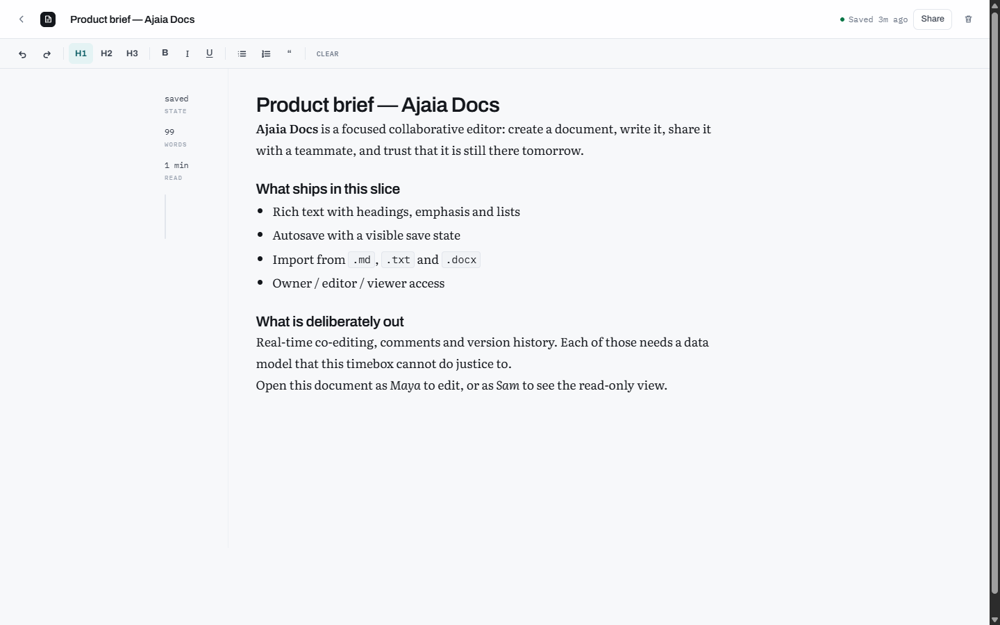

<!-- prettier-ignore -->
<div align="center">


# Ajaia Docs

A scoped collaborative document editor — create, write, comment, import, share, and trust that it survives a refresh.

[](https://nextjs.org)
[](https://www.typescriptlang.org)
[](https://tiptap.dev)
[](#testing)
[](https://ajaia-docs-rho-one.vercel.app)

[Highlights](#highlights) • [Try it](#try-it-in-two-minutes) • [Quick start](#quick-start) • [Testing](#testing) • [How it works](#how-it-works)

</div>



Ajaia Docs is a full-stack document editor built around one path: create a document, write it with real rich text, comment on a passage, share it with a teammate, and have all of it still there after a refresh. It is deliberately small — a few features finished properly rather than many half-built ones.

> [!TIP]
> **Live app:** https://ajaia-docs-rho-one.vercel.app
> **Password for all three demo accounts:** `Ajaia2026!`
> `abdulrahman16baidaq@gmail.com` (owner) · `maya@ajaia.test` (can edit) · `sam@ajaia.test` (can view)
>
> The sign-in screen fills these in with one click, and you can create your own account from `/register`.

## Highlights

- **Editing that behaves.** Bold, italic, underline, three heading levels, bulleted and numbered lists, quotes, inline code, undo/redo. Autosave is debounced at 700 ms with a visible save state, and an optimistic version guard turns a second tab into a clear conflict instead of silent data loss.
- **Comments anchored to the text.** The anchor is a mark inside the document, not a character offset, so it moves with the text as people edit around it. Resolve removes the highlight; deleting the anchored text is detected and reported instead of pointing at the wrong words.
- **Version history.** Every body save is a snapshot, the newest 30 are kept, and restoring writes a new version rather than erasing the list.
- **Sharing with three roles.** Owner, editor, viewer — enforced in every route handler, not in the UI. Strangers receive `404` so the API never confirms a document exists.
- **Import that produces editable content.** `.md`, `.markdown`, `.txt` and `.docx` become documents; **Insert file** appends to the one you are in. Nothing is stored as an attachment, so there is no blob storage to manage.
- **Live sync and presence.** Open tabs converge through a four-second poll: an idle tab adopts a remote change, a busy one refuses and shows a banner. The header shows who else is present.
- **Server-side search** across full document bodies, with a snippet around the match.
- **No paid dependency.** Runs on a local SQLite file in development and Turso in production.

## Try it in two minutes

1. Open the [live app](https://ajaia-docs-rho-one.vercel.app) and press **Abdulrahman** on the sign-in screen.
2. Open **Product brief — Ajaia Docs**, type a sentence, and watch *Unsaved changes* → *Saving…* → *Saved*. Refresh; it is still there.
3. Select a sentence, press **COMMENT**, write a note, reload — the highlight is still on the same words.
4. Press **History**, open a snapshot, then **Restore this version**.
5. Press **Share**, add **Sam Ortiz** as *Can view*, sign in as Sam and open the same document: no toolbar, read-only editor, comments visible but not actionable.
6. Open the document in a second tab, type, and watch the first tab announce *Updated by someone else*.

## Quick start

**Prerequisites:** Node.js 20 or newer and npm. No database server, no Docker, no accounts.

```bash
npm install
npm run db:setup     # creates ./local.db, applies the schema, seeds users and documents
npm run dev          # http://localhost:3000
```

That is the whole setup. Development uses a libSQL file (`./local.db`); production uses Turso. Same engine and the same SQL, so there is no schema drift between them.

### Environment variables

Nothing is required locally. `.env.example` documents the three variables and commits no values.

| Variable | Required | Purpose |
| --- | --- | --- |
| `AUTH_SECRET` | Production | Signs the session JWT. Generate one with `node -e "console.log(require('crypto').randomBytes(48).toString('hex'))"`. |
| `TURSO_DATABASE_URL` | Production | When set, the app talks to Turso instead of `./local.db`. |
| `TURSO_AUTH_TOKEN` | Production | Token for that database. |

> [!IMPORTANT]
> In production the session layer throws if `AUTH_SECRET` is missing, so the first sign-in fails loudly rather than issuing a weak cookie. Locally it falls back to a development-only secret, so a fresh clone works with no configuration at all.

## Testing

```bash
npm test             # 60 unit tests
npm run typecheck    # tsc --noEmit
npm run lint         # eslint
npm run build        # production build
```

The unit suite covers the permission matrix, the import parsers (including a generated `.docx` through the real mammoth build), comment-id validation, version retention, search matching and the HTML/text pipeline.

Against a running server, the API surface is covered end to end:

```bash
node scripts/e2e-api.mjs http://localhost:3000
```

That script runs 39 checks across every endpoint and every role, including the cases that must fail — a viewer writing, a stranger reading, a stale save, an invalid comment id, a duplicate registration — then deletes the document it created. If a run is interrupted, `node scripts/cleanup-qa.mjs` removes the probe account it left behind.

## Project structure

```
src/
  app/                     routes: dashboard, login, register, editor, API handlers
  components/editor/       editor shell, comment mark and rail, history, share dialog
  components/              dashboard, auth forms, shared chrome
  server/                  data access: documents, comments, versions, presence
  lib/                     access rules, auth, import, search, text, validation
  db/                      Drizzle schema, migrations, seed
tests/                     Vitest suites
scripts/                   setup, font download, end-to-end API checks, test-data cleanup
docs/screenshots/          UI captures used in this README
```

## How it works

- **Next.js 15 App Router.** Server components read the database directly; route handlers form a small, explicit API. Every mutation is validated with zod.
- **Tiptap 2 (ProseMirror)** for the editor, so undo, paste and schema behaviour are correct rather than approximated.
- **Drizzle ORM on libSQL** — a file locally, Turso in production. Comments, versions and presence each get one table; retention is bounded.
- **Server-side authorisation** composed from a pure module (`src/lib/access.ts`) that is also the unit-test target.
- **HTML as the interchange format**, with the plain-text projection derived on the server so word counts and search cannot drift from the body.

The architecture note covers the data model, the access matrix, the autosave and sync design, and the deployment gotchas in detail.

## Deployment

Vercel for the app, Turso for the database. Set `AUTH_SECRET`, `TURSO_DATABASE_URL` and `TURSO_AUTH_TOKEN` in the project environment, run `npm run db:setup` once against the remote database, and deploy. Both services have free tiers that are sufficient for this project.

## Documentation

| Document | What it covers |
| --- | --- |
| [`ARCHITECTURE.md`](ARCHITECTURE.md) | Scope decisions, data model, access matrix, autosave, sync, deployment |
| [`AI-WORKFLOW.md`](AI-WORKFLOW.md) | Which AI tools were used, what was accelerated, what was rejected, how it was verified |
| [`SECURITY.md`](SECURITY.md) | What is deliberately public, what is secret, how to rotate |
| [`SUBMISSION.md`](SUBMISSION.md) | What shipped, what was cut, and what comes next |
| [`docs/screenshots/`](docs/screenshots) | Login, dashboard, editor, comments, history, sharing, search, import, mobile |

## Known limits

- **No live cursors.** A CRDT needs a stateful WebSocket server, which this serverless deployment cannot host. Sync is a four-second poll with a version guard, so two people editing inside that window get a clear conflict rather than a merge.
- **No comment replies, mentions or notifications.** One thread per selection.
- **No diff between versions.** A snapshot is previewed whole.
- **Deletion is permanent.** There is no trash.
- **Commenting requires edit access.** There is no separate commenter role.
- **Import appends or creates.** It cannot insert at the cursor.

The demo password is public on purpose — it protects only the seeded demo data. See [`SECURITY.md`](SECURITY.md) if a secret scanner flags it.
